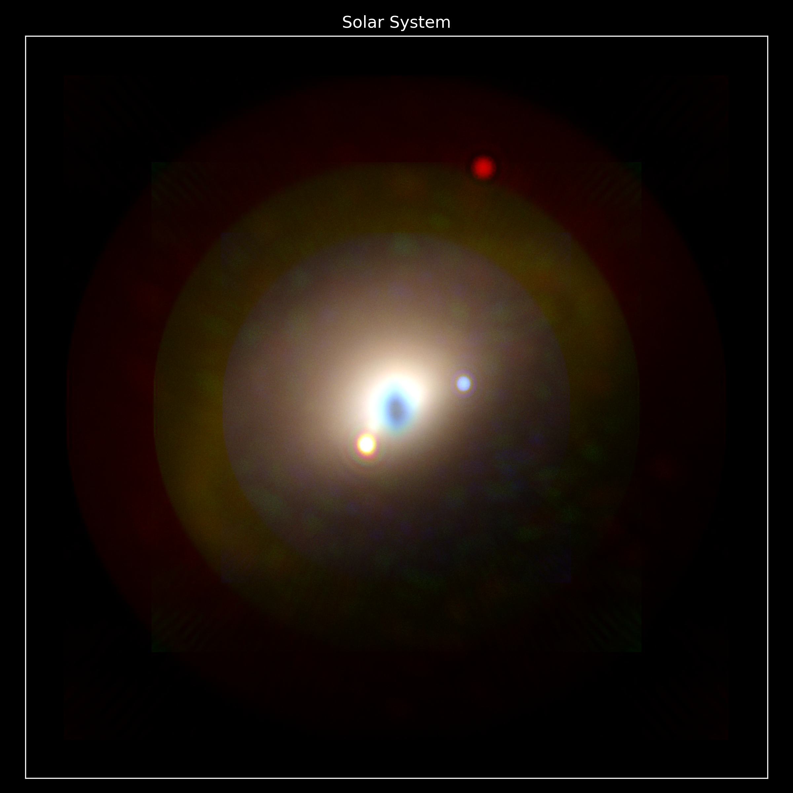

<p align="center">
  
  <br><br>
</p>

<p align="center">
  <a href="https://pypi.org/project/coronagraphoto/"></a>
  <a href="https://coronagraphoto.readthedocs.io"></a>
  <a href="https://github.com/CoreySpohn/coronagraphoto/actions/workflows/ci.yml"></a>
  <a href="https://github.com/CoreySpohn/coronagraphoto/blob/main/LICENSE"></a>
  <a href="https://github.com/CoreySpohn/coronagraphoto/blob/main/pyproject.toml"></a>
  <a href="https://doi.org/10.5281/zenodo.10950736"></a>
</p>

---

# coronagraphoto

**coronagraphoto** is a Python library designed to simulate coronagraphic observations of exoplanetary systems. The base "thing" it produces are images/photos, hence the name. It has been designed to bridge the gap between yield calculations and concrete image generation for missions like the Habitable Worlds Observatory (HWO).

The library integrates high-fidelity coronagraph models from the standard format used for yield calculations (dubbed a "Yield Input Package" and loaded via **[yippy](https://github.com/CoreySpohn/yippy)**) with detailed planetary system simulations (via **[ExoVista](https://github.com/alexrhowe/ExoVista)**) to produce realistic detector images.

Built on **JAX**, `coronagraphoto` supports JIT compilation and differentiation of scene predictions with fixed instrument geometry. JAX provides CPU and accelerator execution.

## Key Features

*   **End-to-End Simulation**: From astrophysical scenes to detector readouts.
*   **JAX & JIT Compatible**: High-performance simulations using functional programming patterns.
*   **Modular Design**: flexible optical paths, easily swappable coronagraphs and detectors.
*   **HWO Ready**: Specifically designed to support yield modeling for future direct imaging missions.

## Installation

```bash
pip install coronagraphoto
```

*(Note: You may need to install JAX separately to match your specific hardware acceleration requirements (CUDA/TPU/CPU).)*

## Photon budgets and detector images

Scenes come from `skyscapes`; hardware and detector statistics come from
`optixstuff`. One `Exposure` record, built once with `build_exposure`, carries
the epoch, roll, wavelength quadrature and frame plan. The image reader takes
`(scene, instrument, exposure)`:

| Function | Output | Units |
|---|---|---|
| `photon_rates` | photon `Rates`, each field `(W, Q, ny, nx)` | photons/s/nm/pixel |
| `expected` | electron `Rates`, each field `(W, ny, nx)` | electrons/s/pixel |
| `observe` | `Image`, data `(W, ny, nx)` | electrons/pixel |

The fields are `planet`, `star_leakage`, `local_zodi`, `exozodi`, `thermal`
and `stellar_companions`; the last two are currently zero. Call `.total()`
to combine terms. Optical throughput excludes detector yield. Only
`detector.electrons` applies QE and survival, at the quadrature nodes.
`observe` calls `detector.draw` once on the combined electron budget.

`expected` scans nodes and accumulates band images, holding one node's
images at a time. `photon_rates` retains all nodes for inspection and small
problems. `build_exposure` builds the quadrature on the host from the scene's
zodi and the instrument. Its Gauss-Legendre rule splits at every declared
break, including detector QE knots. Reuse one exposure across readers, and
change fields with `dataclasses.replace`.

## Exposure times

A yield or scheduling code needs the time to a signal-to-noise ratio for
millions of candidate planets, far more than can each be rendered. The image
path fills tables once and the answer is read from them:

| Function | When | Output |
|---|---|---|
| `aperture_calibration(instrument, quadrature)` | once per instrument and band set | planet throughput against separation, aperture pixel weights |
| `aperture_record(scene, instrument, exposure, calibration)` | once per target and exposure | aperture-summed backgrounds on a half-pixel lattice, planet rate per unit contrast |
| `aperture_rates(record, separation_arcsec, contrast, position_angle_deg=..., time_d=...)` | once per planet and time | aperture `Rates`, photons/s/nm, with `n_pix` and squared-weight `variance` |
| `snr(rates, detector, time_s, frame_time_s=...)` | once per planet | S/N per band |
| `exposure_time(target_snr, rates, detector, frame_time_s=...)` | once per planet | `ExposureTime(time_s, valid)` per band |

The last three are pure array functions for `jax.jit`, `jax.vmap` and
`jax.grad`. The local zodi is read from `scene.zodi` and the disk from the
scene, exactly as in the images. See
[aperture rates and exposure time](docs/explanation/exposure_time.md).

## Quick start

Enable float64 before loading orbital state vectors. This example uses
user-supplied public scene and YIP files; the epoch must lie in the scene's
recorded time range.

```python notest
import jax

jax.config.update("jax_enable_x64", True)

from optixstuff.spectral import Band
from yippy import open_yip
from optixstuff import FramePlan, Instrument
from skyscapes import from_exovista
from coronagraphoto import build_exposure, expected, observe

scene = from_exovista("scene.fits", load_disk=False)
coronagraph = open_yip("yip").prepare()
instrument = Instrument.from_default_setup(
    coronagraph,
    circumscribed_diameter_m=6.0,
    attenuating_throughput=0.4,
    qe=0.8,
    detector_shape=(128, 128),
    pixel_scale_arcsec=0.01,
)
bands = (Band(500.0, 600.0),)
exposure = build_exposure(
    scene,
    instrument,
    bands,
    time_d=0.0,
    roll_deg=30.0,
    plan=FramePlan(frame_time_s=100.0, n_frames=36),
)
rates = expected(scene, instrument, exposure)
image = observe(jax.random.PRNGKey(0), scene, instrument, exposure)
# imshow(image.data[0], origin="lower")
```

For disks, load the disk and construct the coronagraph with a PSF datacube.
The reader requests disk photon radiance on the detector sky grid and passes
its per-pixel flux through the coronagraph's field-dependent PSFs.

Rows increase along detector +y and columns along detector +x. Pixel `(j,i)`
is centred at `(x,y)=(i,j)`, including even grids. `roll_deg` is the position
angle of detector +y, north through east. At zero, east is left and north is
up; at 90 degrees, north is right. A roll changes this orientation for both
planets and disks.

Speckle fields are supplied through `Instrument.speckle`. Their positive excess joins `star_leakage`; their existing
physics is retained. The reader calls `realize(wavelength_nm=..., time_d=...)`
and leaves epoch conversion to the field. The speckle pattern remains fixed
in detector coordinates as pointing rolls.

The former per-source rate/readout functions and bin-centre helper are removed
without aliases. Select record fields for per-source access. See
[rate and observation contracts](docs/explanation/rate_vs_readout.md) and
[JAX and memory](docs/explanation/performance.md) for details.
