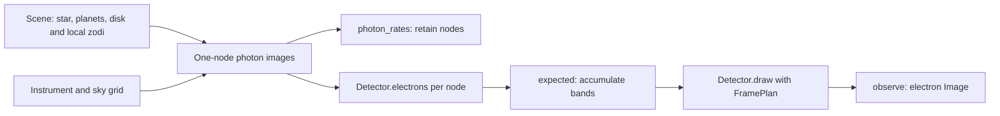

# Architecture

The reader composes shared contracts without owning the underlying physics.

| Quantity or operation | Owner |
|---|---|
| Star and planet photon flux densities; disk photon radiance | skyscapes |
| Local-zodi photon radiance, evaluated for the scene's sky frame and time | skyscapes |
| Orbits and sky offsets | orbix, via skyscapes.Scene |
| Bands, quadrature, frames, grids and resampling | optixstuff |
| Aperture rules and YIP PSFs | yippy |
| Collecting area, optical throughput, coronagraph, detector and frame plan | optixstuff |
| Per-pixel assembly and node streaming | coronagraphoto |
| Aperture tables | coronagraphoto |
| S/N and exposure time from rates | optixstuff |

With collecting area A and throughput T excluding the detector, one node is:

- `planet = A T Phi_planet PSF_pixel`, summed over scene planets.
- `star_leakage = A T Phi_star stellar_map_pixel`, plus the existing positive
  time-dependent speckle excess.
- `local_zodi = A T L_zodi Omega_pixel uniform_sky_map_pixel`.
- `exozodi = A T render_scene(L_disk Omega_pixel)`.

Each wavelength uses the source, stellar and uniform-sky grids of its selected
imaging band. A system with a disk requires a scene-capable band, such as a
prepared YIP with `with_scene_operator()`. An unsupported illuminated position
contributes zero to the corresponding planet or disk rate image. The
coronagraph reports it (`SourcePSFs.valid` per planet, `SceneRender.valid` for
the scene); the rate image does not carry that flag, so a caller that must not
miss such light checks it before rendering. Zero-flux planets and dark scene
pixels require no response.

Photon quantities come directly from the scene. Photon `Rates` retains those
four terms, a uniform thermal term from `Instrument.warm_emission` and a zero
companion field. `expected` sends each
photon record carrying that node's wavelength and integration weight to `detector.electrons`.
`observe` calls `detector.draw` after all electron terms have been accumulated.

The ExoVista loader (`skyscapes.from_exovista`) builds the scene and native
stored-disk geometry and adds an AYO photon background. Arrays use `(y,x)`, pixel centres
use `(x,y)`, and the exposure's `pointing.roll_deg` describes the observation roll.

The aperture tables are a reduction of the same node images. The background
terms of one render are summed in a photometric aperture at every half-pixel
position, and the planet term is replaced by a throughput curve calibrated
once per instrument. `optixstuff.snr` and `optixstuff.exposure_time` then read
`detector.mean_and_variance`, so the analytic exposure time and a drawn image
share one statistical model. See
[aperture rates and exposure time](exposure_time).
