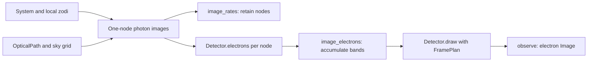

# Architecture

The reader composes shared contracts without owning the underlying physics.

| Quantity or operation | Owner |
|---|---|
| Star and planet photon flux densities; disk photon radiance | skyscapes |
| Local-zodi photon radiance | zodi.jax |
| Orbits and sky offsets | orbix, via skyscapes.System |
| Bands, quadrature, frames, grids and resampling | hwoutils |
| Aperture rules and YIP PSFs | yippy |
| Collecting area, optical throughput, coronagraph, detector and frame plan | optixstuff |
| Per-pixel assembly and node streaming | coronagraphoto |

With collecting area A and throughput T excluding the detector, one node is:

- `planet = A T Phi_planet PSF_pixel`, summed over scene planets.
- `star_leakage = A T Phi_star stellar_map_pixel`, plus the existing positive
  time-dependent speckle excess.
- `local_zodi = A T L_zodi Omega_pixel background_transmission_pixel`.
- `exozodi = A T extended_scene(L_disk Omega_pixel)`.

Photon quantities come directly from the scene. `PhotonRates` retains those
four terms and zero thermal/companion fields. `image_electrons` sends each
one-node photon record and its one-node quadrature to `detector.electrons`.
`observe` calls `detector.draw` after all electron terms have been accumulated.

The ExoVista loader delegates the scene and native stored-disk geometry to
skyscapes and adds an AYO photon background. Arrays use `(y,x)`, pixel centres
use `(x,y)`, and a single `SkyOrientation` describes the observation roll.
